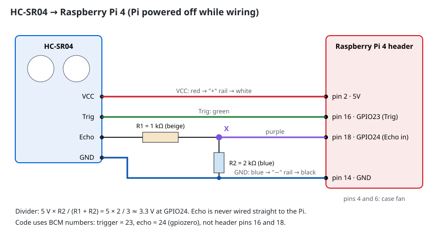

<!-- AI-assisted (Claude Code), reviewed by a team member. -->
# Optional sensor module

An optional sensor module: a Raspberry Pi 4 with an HC-SR04 ultrasonic sensor next to the laptop webcam gives a
second face-to-screen distance that does not depend on the face model, and a Camera Module 2 logs an ambient
light estimate. The app works fully without it; the test still runs on the laptop and its webcam.

## Parts

| Part | Role | Note |
|---|---|---|
| Raspberry Pi 4 (8 GB) | Reads the sensors, serves numbers over WebSocket | Set up over SSH; monitor only for the demo page |
| USB stick, 32 GB | System disk instead of microSD | Writing the OS erases it |
| USB-C power supply, 5.1 V 3 A | Power | A weak supply throttles the Pi (`vcgencmd get_throttled` should be `0x0`) |
| HC-SR04 | Distance to the face | Echo outputs 5 V: only through the divider |
| Resistors 1 kΩ and 2 kΩ | Voltage divider 5 V → 3.3 V on Echo | Required |
| Breadboard, 4 male–female jumper wires | Assembly without soldering | |
| Raspberry Pi Camera Module 2 | Ambient light estimate from exposure metadata | Optional; the server runs with `--no-camera` |
| Clip or double-sided tape, cardboard | Holds the sensor next to the webcam, facing the face | Must not move: one offset per mounting |
| Eye patch | Covers the other eye | A palm near the eye is in the sensor's beam |

## Wiring

| HC-SR04 | Wire | Pi header pin | GPIO (BCM) |
|---|---|---|---|
| VCC | red → "+" rail → white | 2 (5V) | — |
| GND | blue → "−" rail → black | 14 (GND) | — |
| Trig | green | 16 | GPIO23 |
| Echo, through the divider (point X) | purple | 18 | GPIO24 |

R1 = 1 kΩ between Echo and X, R2 = 2 kΩ between X and GND: 5 V × 2 / (1 + 2) ≈ 3.3 V at GPIO24. Echo is never
wired directly to the Pi. Pins 4 and 6 are used by the case fan. The code uses BCM numbers (`trigger=23`, `echo=24`).

## Installing the system and the server

Step by step in [`pi/README.md`](../pi/README.md): Raspberry Pi OS (64-bit) with desktop written by Raspberry Pi
Imager, the apt packages `python3-gpiozero python3-lgpio python3-websockets python3-picamera2`, the systemd
service `pi/sensor-server.service`, the status page `pi/status.html` and the check with `pi/check_client.py`.

## Mounting and calibration

1. Fix the sensor next to the laptop webcam, facing the participant's face, perpendicular to the screen. Keep
   hands and an external keyboard out of the space between sensor and face.
2. Start `node serve.mjs` on the laptop and open `http://localhost:8000/hw.html`. Enter the Pi address
   (`vision.local:8765` in our setup) and press **Connect**.
3. Sit so that your eyes are 500 mm from the screen (measure with a ruler), press **Save**. This stores
   `offsetMm = 500 − median raw distance` in the browser (`localStorage`, key `sensor_offset_mm`).

The offset belongs to the sensor mounting, not to a person. If the sensor moves, calibrate again; measured
errors apply only to the mounting that was measured.

`sensorMm = median(raw mm over the last 0.5 s) + offsetMm`.

## WebSocket messages

The Pi listens on port 8765 and sends, to every connected client:

| Message | When |
|---|---|
| `{"v":1,"hello":"sensor-pi","camera":true}` | once, after connecting |
| `{"v":1,"mm":512,"ok":1,"lux":310.5}` | every 60 ms; `mm` is the raw distance in whole mm. `ok: 0` and `mm: null` when the read failed or is outside 100–2000 mm. `lux` is `null` without a camera |
| `{"v":1,"clients":2}` | when the number of clients changes (shown on `pi/status.html`) |

No averaging on the Pi; the browser (`src/hw-link.js`) takes the median of the last 0.5 s. Camera frames are
neither stored nor sent: only these numbers leave the Pi.

`getSensorDistance()` in `src/hw-link.js` returns `{ mm, ageMs, ok, reason }`, the same shape as `getDistance()`
for the camera. Reasons: `needs_localhost`, `not_connected`, `stale` (newest reading older than 0.5 s),
`not_calibrated`, `out_of_range`.

## Running the app with the module

The browser blocks `ws://` connections from `https` pages, so with the module the app is opened from a local
server on the laptop (`node serve.mjs`, then `http://localhost:8000/`), and the laptop and the Pi are on the
same network (direct Ethernet cable or a phone hotspot). Without the module, GitHub Pages works as before; there
`hw.html` shows `needs_localhost` instead of connecting.

## Results

Experiment 5 (sensor vs tape at 300, 400, 500, 670 and 1000 mm, 3 people × 3 repeats; criterion fixed before
the first measurement: mean absolute error ≤ 10 % at every distance) has **not been run yet**. Numbers are
added here only from `analysis/out/summary.md`, with N, after the run. Raw rows go to `data/raw/sensor_check.csv`
(columns `participant,glasses,tapeMm,sensorRawMm,sensorMm,cameraMm,lux,timestamp`), exported from `hw.html`.

## Limitations

- The ultrasonic sensor measures the distance to the nearest surface in its beam, not to the eye: forehead,
  a hand, hair or a keyboard in the beam change the reading.
- One offset per sensor mounting; moving the sensor invalidates the calibration.
- Light is the camera's exposure-based estimate, not checked against a reference light meter, and it is the
  light in the camera's view, not at the eye. It is logged as a reading, with no accuracy claim.
- With the module the app runs from localhost, not from GitHub Pages; the Pi and the laptop must be on the same
  network.
- On Linux the echo pulse is timed in software (gpiozero, lgpio pin factory), so single readings jitter.
- A breadboard prototype on jumper wires; not tested in microgravity or for vibration.

## Datasheet values

From the HC-SR04 datasheet ([SparkFun copy](https://cdn.sparkfun.com/datasheets/Sensors/Proximity/HCSR04.pdf)),
datasheet values, not our measurement: range 2 cm – 4 m, measuring angle 15°, supply 5 V DC, 15 mA,
10 µs trigger pulse, measurement cycle of 60 ms or more recommended. The server keeps its own working range to
100–2000 mm.

## Libraries and licences

| Library | Used for | Licence |
|---|---|---|
| [gpiozero](https://github.com/gpiozero/gpiozero) | HC-SR04 (`DistanceSensor`) | BSD-3-Clause |
| [lgpio](https://abyz.me.uk/lg/py_lgpio.html) | gpiozero pin factory on the Pi 4 | Unlicense (public domain) |
| [picamera2](https://github.com/raspberrypi/picamera2) | Light estimate (`Lux` in frame metadata) | BSD-2-Clause |
| [websockets](https://github.com/python-websockets/websockets) | WebSocket server on the Pi | BSD-3-Clause |
