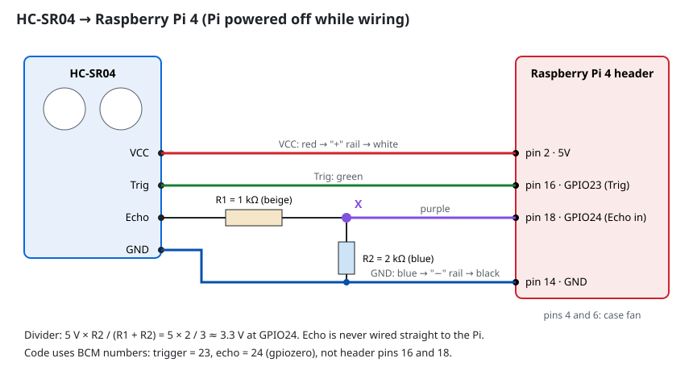

<!-- AI-assisted (Claude Code), reviewed by a team member. -->
# pi/: code that runs on the Raspberry Pi 4

Two independent servers live here:

- **`sensor_server.py`: the optional sensor module.** Reads an HC-SR04 ultrasonic distance sensor (and the
  ambient light estimate of a Camera Module 2) and sends the numbers to the laptop's browser over WebSocket.
  The test itself still runs on the laptop with its own webcam. Details, results and limits: `docs/hardware.md`.
- **`camera_server.py`: the Pi camera as the app's camera** (section at the end).

Do not run both at once: both use port 8000 for http and both open the Camera Module 2.

## Sensor module (`sensor_server.py`)

| File | What it is |
|---|---|
| `sensor_server.py` | HC-SR04 + Camera Module 2 → WebSocket on port 8765; serves `status.html` on port 8000 |
| `check_client.py` | Prints the server's messages. Standard library only: runs on the Pi and on the laptop |
| `sensor-server.service` | systemd unit: starts the server at boot, restarts it if it stops |
| `status.html` | Demo page for the Pi's monitor: big distance, 10 s graph, light, clients connected |
| `sensor-kiosk.desktop` | Opens `status.html` full screen after the Pi's desktop logs in |
| `wiring.svg` | Wiring diagram with the voltage divider |
| `test_sensor_server.py` | Unit tests and an end-to-end WebSocket test, no Pi needed |

### 1. Write the system

1. On the laptop, open **Raspberry Pi Imager**. Device: Raspberry Pi 4. OS: **Raspberry Pi OS (64-bit)**, the
   version *with desktop* (the desktop shows `status.html` during the demo). Storage: the 32 GB USB stick.
   Writing erases the stick completely.
2. In the Imager's OS customisation set the hostname (ours: `vision`, so the Pi is `vision.local`), the user
   (ours: `user`), Wi-Fi (or a phone hotspot) and **enable SSH** with password login.
3. Put the stick in a USB port of the Pi, connect the power supply (USB-C, 5.1 V 3 A) and wait about a minute.
   If the Pi does not boot from USB, its bootloader needs updating: write *Misc utility images → Bootloader →
   USB Boot* to a borrowed microSD card, boot the Pi from it once, then remove the card.
4. From the laptop: `ssh user@vision.local`. The laptop and the Pi must be on the same network (a phone hotspot
   works; hackathon Wi-Fi often blocks devices from seeing each other).

Checked on our Pi on 14.11: Raspberry Pi OS on Debian 13 (trixie) boots from the stick, `vision.local` answers
over SSH through a phone hotspot, Camera Module 2 is detected and reports `Lux`, `vcgencmd get_throttled` = `0x0`.

### 2. Install the packages (Pi needs internet once)

```bash
sudo apt update
sudo apt install -y python3-gpiozero python3-lgpio python3-websockets python3-picamera2 git
git clone https://github.com/capitalisming/Vision.git ~/Vision
```

No pip. `gpiozero` uses the `lgpio` pin factory on the Pi 4 by default.

### 3. Wire the sensor (Pi powered off)



| HC-SR04 | Wire | Pi header pin | GPIO (BCM) |
|---|---|---|---|
| VCC | red → "+" rail → white | 2 (5V) | — |
| GND | blue → "−" rail → black | 14 (GND) | — |
| Trig | green | 16 | GPIO23 |
| Echo, **through the divider** (point X) | purple | 18 | GPIO24 |

Divider: R1 = 1 kΩ (beige) between Echo and X, R2 = 2 kΩ (blue) between X and GND. The Pi gets
5 V × 2 / 3 ≈ 3.3 V. **Echo outputs 5 V; never wire it straight to a Pi pin.** Pins 4 and 6 are taken by the
case fan. Header pin 1 is at the end of the header away from the USB ports.

`gpiozero` counts BCM numbers, so the code says `trigger=23, echo=24`, not 16 and 18.

Before powering on, check by eye: no wire goes from the Echo row to the Pi directly; pin 2 (5 V) touches
nothing but VCC.

### 4. Run it by hand first

```bash
cd ~/Vision
python3 pi/sensor_server.py              # with Camera Module 2
python3 pi/sensor_server.py --no-camera  # HC-SR04 only; lux is null
```

It prints the pin factory, whether the camera started, and the two addresses. If the camera is missing or busy
it says so and goes on without light readings. `--port`, `--http-port` (0 = off) and `--host` change the defaults.
gpiozero warns `PWMSoftwareFallback` once: on the Pi the pulse length is timed in software, so readings jitter
by a few mm; the browser takes the median.

In a second SSH window, or on the laptop:

```bash
python3 pi/check_client.py --seconds 5            # on the Pi
python pi/check_client.py vision.local --seconds 5  # on the laptop (any OS, nothing to install)
```

Expected: one `{"v":1,"hello":"sensor-pi","camera":true}`, a `{"v":1,"clients":N}`, then about 16 lines per
second like `{"v":1,"mm":512,"ok":1,"lux":310.5}`, and a summary line. Hold a book at 300, 500 and 1000 mm by the
tape: the median should be within 10 % (the plan's check before any face measurement).

### 5. Start it at boot

```bash
sudo cp pi/sensor-server.service /etc/systemd/system/
sudo systemctl daemon-reload
sudo systemctl enable --now sensor-server
systemctl status sensor-server      # running?
journalctl -u sensor-server -f      # its log
```

The unit assumes the clone is at `/home/user/Vision` and the user is `user`; edit both if not. Without the
camera add `--no-camera` to `ExecStart`. After `sudo reboot`, `check_client.py` should connect without
starting anything by hand.

### 6. Status page on the Pi's monitor

Monitor on the micro-HDMI port next to USB-C (HDMI0). Then:

```bash
mkdir -p ~/.config/autostart && cp pi/sensor-kiosk.desktop ~/.config/autostart/
```

After the next login Chromium opens `http://localhost:8000/status.html` full screen (Alt+F4 closes it). Any
device on the same network can open the same page at `http://vision.local:8000/status.html`.
"Other clients connected" counts every client except the page itself, so with the laptop's `hw.html` open it
shows 1 and "laptop connected".

### Message format (WebSocket, port 8765)

| Message | When |
|---|---|
| `{"v":1,"hello":"sensor-pi","camera":true}` | once, right after connecting |
| `{"v":1,"mm":512,"ok":1,"lux":310.5}` | every 60 ms. `mm`: raw distance, integer mm, no offset, no averaging. `ok: 0, mm: null` when the read failed, no echo came in the last 200 ms, or the distance is outside 100–2000 mm. `lux`: camera estimate or `null` |
| `{"v":1,"clients":2}` | when the number of connected clients changes (for `status.html`; `src/hw-link.js` ignores it) |

The sensor is read by gpiozero's own thread every 60 ms (`DistanceSensor`, `queue_len=1`: no smoothing).
gpiozero keeps the last good value when a read fails, so the server records when each read succeeded and
sends `ok: 0` if the newest successful read is older than 200 ms.

### Tests

```bash
python3 -m unittest discover -s pi
```

Without gpiozero / websockets installed (e.g. on Windows) the tests that need them are skipped. They use
gpiozero's `MockFactory`, not the real sensor: readings on the hardware are checked by a person with a tape.

### Status

Not yet run on the real Pi with the HC-SR04 connected. Tested here: message format, 100–2000 mm range, stale
reads, gpiozero `DistanceSensor` against gpiozero's mock pins (gpiozero 2.0.1), the WebSocket server
(websockets 15.0.1) end to end with `check_client.py`, and `status.html` / `hw.html` in Chromium against the
server with a stand-in reader. The kiosk autostart and the systemd unit are not tested on the Pi yet.

## Raspberry Pi 4 camera (`camera_server.py`)

`camera_server.py` lets the Vision app use a camera attached to a Raspberry Pi 4. It keeps only the newest
camera frame in memory and serves it at `/frame`. It also serves the app itself, so a laptop on the same network
opens the app from the Pi and gets its camera. Frames are never written to disk.

The face detection (MediaPipe, `vendor/`) runs in the laptop's browser. The Pi only streams pictures.

### Run on the Pi

Raspberry Pi OS (Bookworm) with either camera:

- **Pi Camera Module (CSI ribbon):** uses `picamera2` and the Pi's hardware MJPEG encoder. If it is missing,
  install it with `sudo apt install python3-picamera2`.
- **USB webcam:** uses OpenCV. Install it with `sudo apt install python3-opencv`.

```bash
git clone <this repository> && cd Vision
python3 pi/camera_server.py
```

It prints the camera it found. `--source picamera2` or `--source opencv` forces one, and `--device 1` picks
another USB camera. Defaults: 640x480, port 8000.

### Use it from the laptop

1. Open `http://raspberrypi.local:8000/` (or `http://<pi-ip>:8000/`; on the Pi, `hostname -I` shows the IP).
2. Calibrate the screen on that page. Screen calibration is stored per address, so it has to be done once here too.
3. Open **Test**, fill in step 1 (you) and step 2 (screen), then in step 3 (distance) choose **Camera**. Under
   *Camera source* choose **Raspberry Pi** and leave the address empty. You should see the live picture, the eye
   points and a message such as `No face found`, or the distance.
4. Calibrate the camera there (sit at the known distance, press Calibrate). **Each camera has its own
   calibration**: the app stores it per camera and does not start a camera test for a camera that was not calibrated.
5. Press **Start test**.

#### App served by the laptop instead

You can run the app on the laptop and take only the camera from the Pi. Start the server with the laptop
page's origin:

```bash
python3 pi/camera_server.py --allow-origin http://localhost:5178
```

Then enter the Pi address (e.g. `raspberrypi.local:8000`) under *Camera source* in step 3 of the Test flow. Without `--allow-origin` the
server refuses cross-origin reads, so other web pages cannot read the camera.

This does **not** work from GitHub Pages: an https page cannot load an http camera.

### Without a Pi, and running the site locally

`python3 pi/camera_server.py --source fake` serves the app and a moving test pattern. It needs only the Python
standard library, so the whole chain can be tried on any computer. The pattern has no face, so the distance
shows `no_face`.

Careful with `python -m http.server`: on Windows it can serve `.mjs` files as `text/plain`, and the browser then
refuses to load MediaPipe ("Failed to fetch dynamically imported module"). `pi/camera_server.py` and
`node serve.mjs` (open `/index.html`) set the right types.

Tests: `python -m unittest discover -s pi`

### Status and limits

- Tested with `--source fake`: stream into the app, MediaPipe running on that stream, calibration guard,
  camera test that refuses a number when no face is seen. Not run on a real Raspberry Pi 4 and not with a real
  face yet, so the accuracy of the distance from the Pi camera is unmeasured (Experiment 3 covers it).
- The picamera2 part follows `examples/mjpeg_server_2.py` in raspberrypi/picamera2-examples.
- `src/distance.js` (participant 2) got a small change so that the Pi stream can be used:
  `setCameraProvider(provider, id)`, calibration stored per camera id, and `startDistance` starts again when its
  video has no stream. The default webcam path is unchanged.
- Anyone on the same network can open the camera page. Use a trusted network, or pass `--host` to limit the
  listening address.
